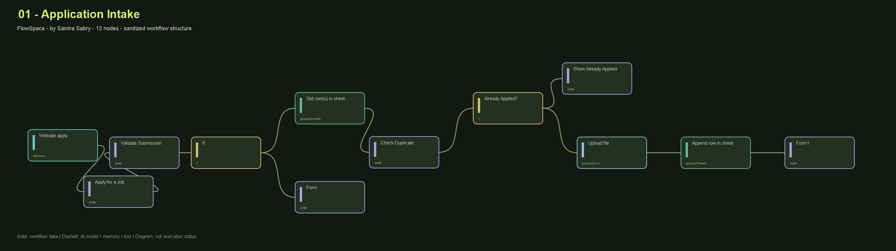

# 01 · Application Intake

[Back to portfolio](../../README.md) · [Download the workflow template](../../workflows/intake.json)

[Open scalable SVG](../images/01-application-intake.svg)

## Purpose

Collect a candidate application and PDF CV, validate the submission and avoid duplicate applications.

| Item | Details |
| --- | --- |
| Trigger | Production webhook |
| Input | Full name, email, position, optional motivation and a PDF CV. |
| Output | A CV file in Google Drive, an application row in Google Sheets, or a validation/duplicate response. |
| Services | Google Sheets, Google Drive, n8n Webhook and Code nodes. |
| Nodes | 12 |

## Processing steps

1. The website sends a multipart request to the authenticated intake webhook.
2. The normalization and validation nodes check candidate details and the CV.
3. The workflow reads existing applications and checks for a duplicate email/position.
4. Invalid or duplicate submissions return a specific response.
5. A valid new application uploads its CV to Drive and appends a row to the Applications sheet.

## Validation checklist

Submit a valid PDF using your own test details, verify the Drive file and sheet row, then repeat the same email/position and verify duplicate rejection.

These are checks to perform, not a claim that every end-to-end test has passed.

## Operational notes

Submitting an application does not mean AI screening has already finished. The screening workflow processes the queue separately.

## Setup

Import the cleaned JSON into n8n, connect your own credentials and replace CONFIGURE_* placeholders. Configure the public webhooks with Header Auth before activating write operations. Keep provider tokens and private Google resource IDs out of the public repository.
