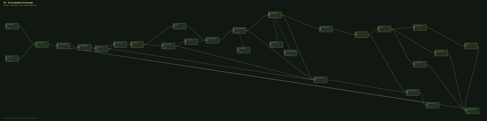

# 02 · AI Candidate Screening

[Back to portfolio](../../README.md) · [Download the workflow template](../../workflows/screen.json)

[Open scalable SVG](../images/02-ai-candidate-screening.svg)

## Purpose

Process pending applications, extract candidate information, score a CV against the role and route the result.

| Item | Details |
| --- | --- |
| Trigger | Hourly schedule or manual execution |
| Input | Pending application records and their linked CV files in Google Drive. |
| Output | Updated application records and the configured interview, decline or HR-review notification paths. |
| Services | Google Sheets, Google Drive, Gmail, Google Gemini and Groq. |
| Nodes | 28 |

## Processing steps

1. An hourly Schedule Trigger or the manual trigger starts the batch.
2. Google Sheets supplies the pending applications, which are processed through the application loop.
3. The CV is downloaded from Drive and text extraction is attempted. A Gemini document-analysis branch handles the alternate extraction path.
4. An information-extraction node builds the candidate profile. A Groq-backed scoring chain uses a structured output parser.
5. Validation checks the AI result before the decision and review branches continue.
6. The workflow updates the sheet and runs the configured candidate/HR email branch.

## Validation checklist

Use a dedicated test application, run the batch manually, inspect its score/status update and confirm the intended email branch with your own test recipient.

These are checks to perform, not a claim that every end-to-end test has passed.

## Operational notes

This workflow can send real emails when configured and executed. Its assessment supports recruitment review; the diagram is not evidence of a completed candidate evaluation.

## Setup

Import the cleaned JSON into n8n, connect your own credentials and replace CONFIGURE_* placeholders. Configure the public webhooks with Header Auth before activating write operations. Keep provider tokens and private Google resource IDs out of the public repository.
