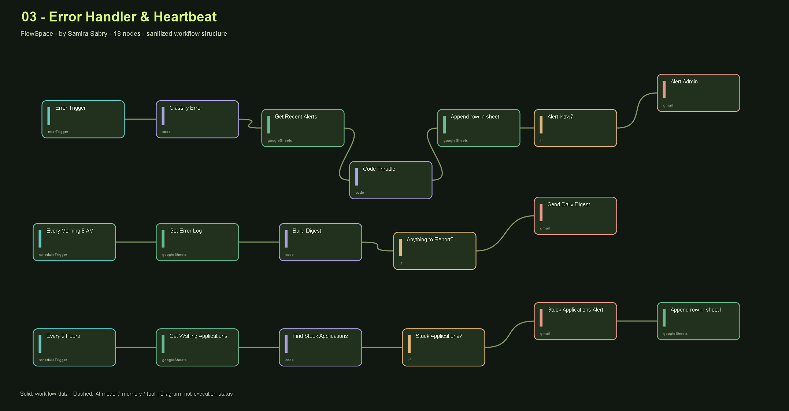

# 03 · Error Handler & Heartbeat

[Back to portfolio](../../README.md) · [Download the workflow template](../../workflows/monitor.json)

[Open scalable SVG](../images/03-errors-and-heartbeat.svg)

## Purpose

Collect execution failures, limit repeated notifications, produce a daily digest and identify stalled applications.

| Item | Details |
| --- | --- |
| Trigger | Error Trigger, daily 08:00 schedule and a two-hour schedule |
| Input | n8n error events, recent error/alert records and waiting application records. |
| Output | Error-log entries, selected immediate alerts, daily digests and stalled-application alerts. |
| Services | Google Sheets, Gmail, n8n Error Trigger, Schedule Trigger and Code nodes. |
| Nodes | 18 |

## Processing steps

1. The Error Trigger receives failures from workflows linked to this error workflow.
2. Classify Error and the alert-history/throttle nodes decide whether an immediate notification should be sent.
3. The error is recorded in Google Sheets and the selected alert branch can email the administrator.
4. At 08:00, a separate branch reads the error log and builds a digest, sending it only when there is something to report.
5. Every two hours, the heartbeat branch reads waiting applications, identifies stalled items and follows its alert/logging path.

## Validation checklist

Use a separate test copy to cause a controlled workflow failure. Verify the error log and alert, then repeat the error to check throttling. Run the digest and heartbeat branches against test data.

These are checks to perform, not a claim that every end-to-end test has passed.

## Operational notes

Schedules use the configured n8n workflow timezone. The exported workflow uses Africa/Cairo. Attach this workflow in each monitored workflow’s Error workflow setting.

## Setup

Import the cleaned JSON into n8n, connect your own credentials and replace CONFIGURE_* placeholders. Configure the public webhooks with Header Auth before activating write operations. Keep provider tokens and private Google resource IDs out of the public repository.
