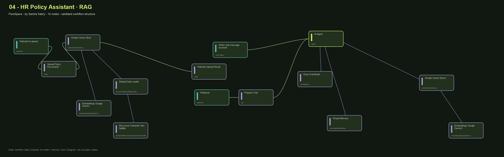

# 04 · HR Policy Assistant · RAG

[Back to portfolio](../../README.md) · [Download the workflow template](../../workflows/hr.json)

[Open scalable SVG](../images/04-hr-policy-assistant.svg)

## Purpose

Answer employee questions using policy-document retrieval and conversational context.

| Item | Details |
| --- | --- |
| Trigger | Chat Trigger or production chat webhook; separate private policy-upload webhook |
| Input | A user question and session ID. Policy documents are loaded through the separate owner-controlled ingestion route. |
| Output | An assistant answer grounded in retrieved policy context, with source information when supplied by the workflow. |
| Services | Groq, Gemini embeddings, n8n AI Agent, Simple Memory and the in-memory vector store. |
| Nodes | 15 |

## Processing steps

1. On the private ingestion branch, policy documents are normalized and passed to the Default Data Loader.
2. The Recursive Character Text Splitter creates chunks. Gemini embeddings store them in the in-memory vector store.
3. A website question enters through the chat webhook and Prepare Chat; the Chat Trigger is an alternate entry point.
4. The Groq-backed AI Agent uses Simple Memory for the session and the vector-store tool to retrieve relevant policy passages.
5. The resulting answer is returned to the website; unsupported questions should be referred to HR rather than answered from invented policy.

## Validation checklist

Load a known policy, ask a question whose answer is in it, ask the same topic in Arabic, then ask a question outside the document and verify the fallback response.

These are checks to perform, not a claim that every end-to-end test has passed.

## Operational notes

The current vector store is temporary and is cleared by n8n restarts. Automatic policy reloading/Policy Loader remains a separate setup and restart-test task. The public website does not expose the policy-upload interface.

## Setup

Import the cleaned JSON into n8n, connect your own credentials and replace CONFIGURE_* placeholders. Configure the public webhooks with Header Auth before activating write operations. Keep provider tokens and private Google resource IDs out of the public repository.
