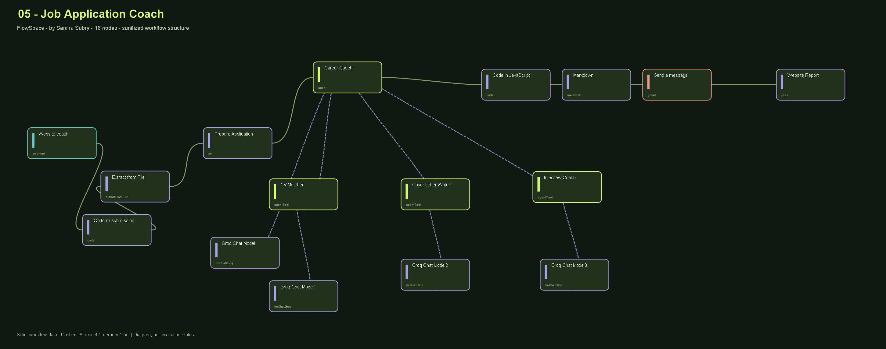

# 05 · Job Application Coach

[Back to portfolio](../../README.md) · [Download the workflow template](../../workflows/coach.json)

[Open scalable SVG](../images/05-job-application-coach.svg)

## Purpose

Review a CV against a job description and coordinate specialist agents for application preparation.

| Item | Details |
| --- | --- |
| Trigger | Production webhook |
| Input | Full name, email, target job title, job description and PDF CV. |
| Output | A coaching report returned to the website and a configured Gmail report-delivery path. |
| Services | Groq, Gmail, n8n AI Agent/tools, PDF extraction and Markdown conversion. |
| Nodes | 16 |

## Processing steps

1. The website submits the CV and job details to the authenticated coaching webhook.
2. The normalization node and Extract from File prepare the application context.
3. The Career Coach orchestrates the CV Matcher, Cover Letter Writer and Interview Coach tools.
4. Groq chat-model nodes support the main agent and specialist tools.
5. Report-processing nodes prepare the report, convert Markdown to HTML and run the configured Gmail delivery step.
6. Website Report normalizes the response returned to the visitor.

## Validation checklist

Submit your own test CV and job description, inspect all specialist outputs and verify both the website response and report-email delivery.

These are checks to perform, not a claim that every end-to-end test has passed.

## Operational notes

Processing can take time. A timeout in the browser does not prove the workflow stopped; inspect n8n Executions before submitting a duplicate request.

## Setup

Import the cleaned JSON into n8n, connect your own credentials and replace CONFIGURE_* placeholders. Configure the public webhooks with Header Auth before activating write operations. Keep provider tokens and private Google resource IDs out of the public repository.
